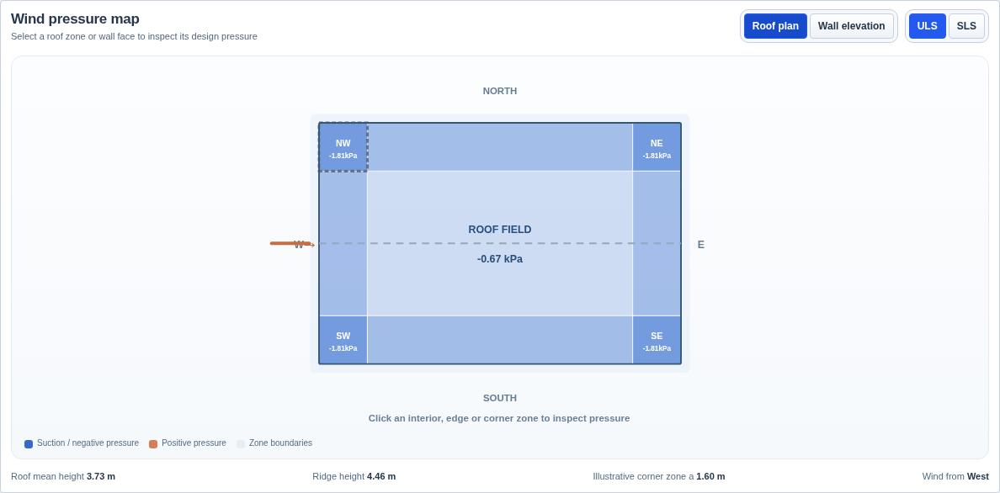
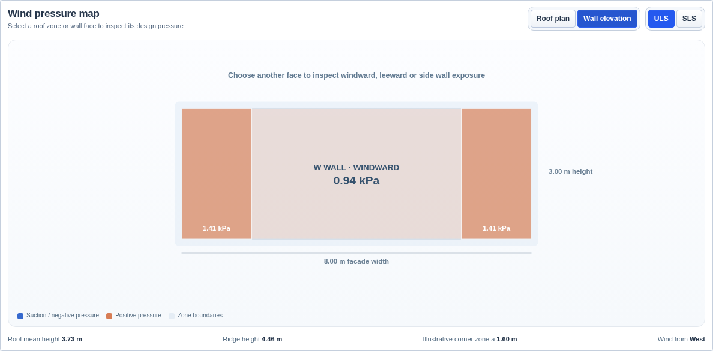

# Software subscriptions

Choose a program to open its checkout on Stripe. Each subscription renews monthly in Australian dollars.

| Software | Subscription | Checkout |
|---|---|---|
| Visual Engineering | A$100 per month | [Subscribe to Visual Engineering](https://buy.stripe.com/dRm5kC0rvaq16Uack8afS01) |
| OzziGeoLab | A$100 per month | [Subscribe to OzziGeoLab](https://buy.stripe.com/14A5kCa250Pr7Yeac0afS02) |
| OzziPDF | A$100 per month | [Subscribe to OzziPDF](https://buy.stripe.com/6oUcN4a2555Hceu2JyafS03) |
| OzziLocation | A$100 per month | [Subscribe to OzziLocation](https://buy.stripe.com/9B614mdeh1Tvdiybg4afS04) |

## Visual Engineering · WindLab for Windows

WindLab for Windows looks up addresses in Queensland and New South Wales. Review the indicative wind region, compare wind actions across building faces and export the results to PDF. The Visual Engineering subscription covers the WindLab evaluation workflow for one engineering practice.

## Explore an example

These screenshots and the report use the same fictional building and example inputs. The roof view identifies corner and edge zones. The wall view shows how the selected wind direction changes pressure across the faces.

[Download the example wind report (PDF)](media/sample-wind-report.pdf)

An engineer must confirm the wind region, site assumptions, geometry, openings and pressure coefficients before using results on a project. Whole-shed stability and connection qualification remain under development.

## Software acquisition

**A$20,000 asking price** for an exclusive acquisition of the Visual Engineering source and transferable rights. Package contents, third-party licences and handover terms are available for discussion before purchase.

[Enquire about acquisition](https://github.com/Netorezende23224/visual-engineering-demo/issues/new?title=Visual%20Engineering%20acquisition%20enquiry)
